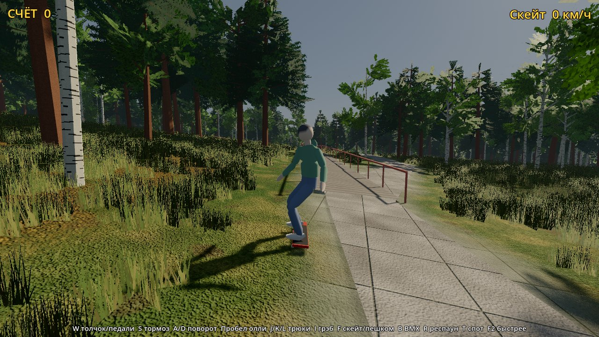
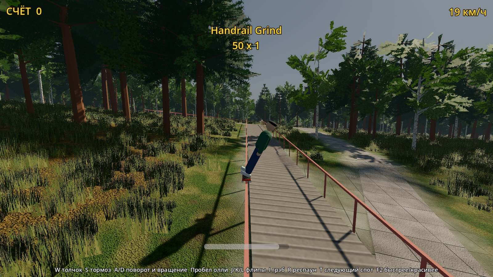
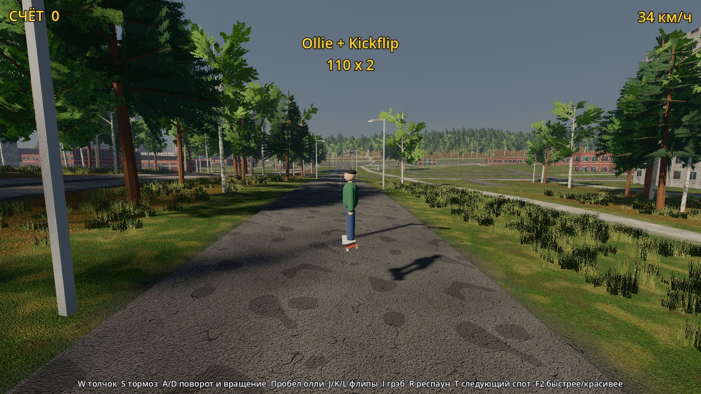
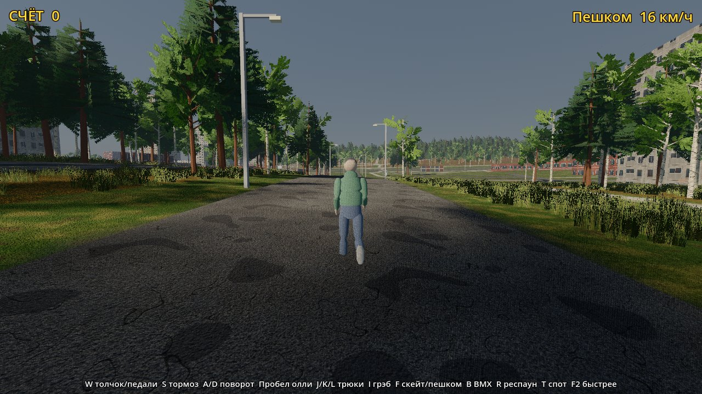
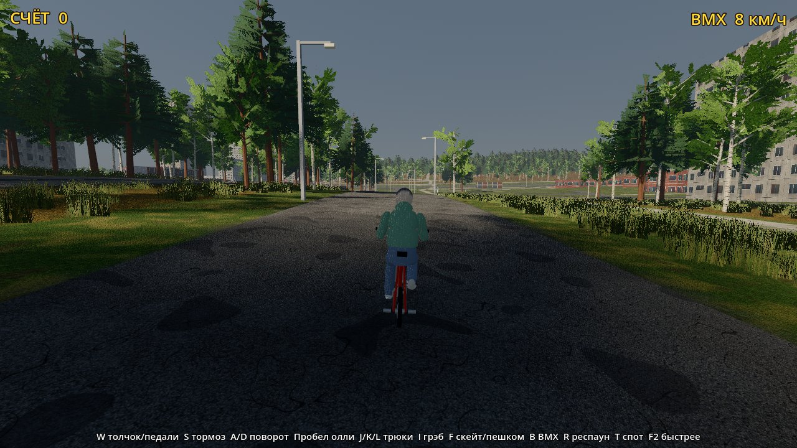
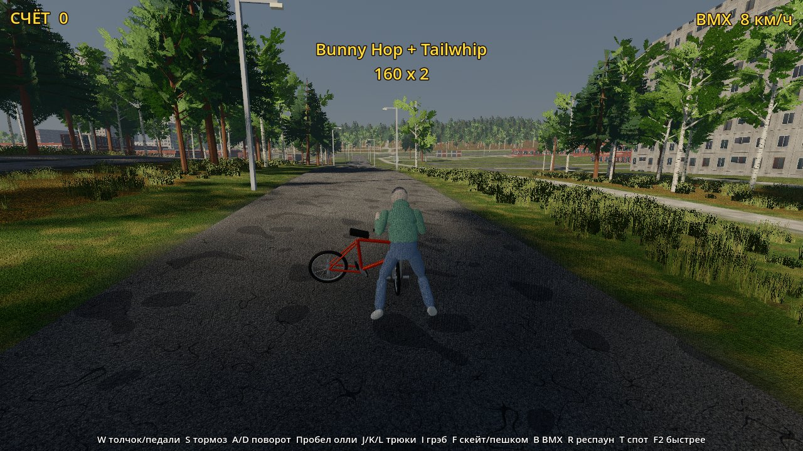
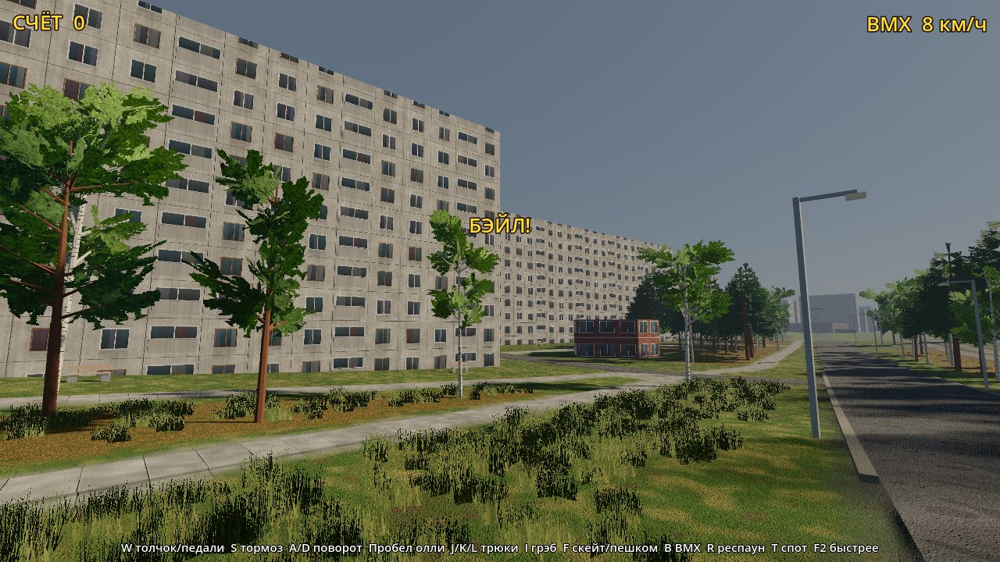
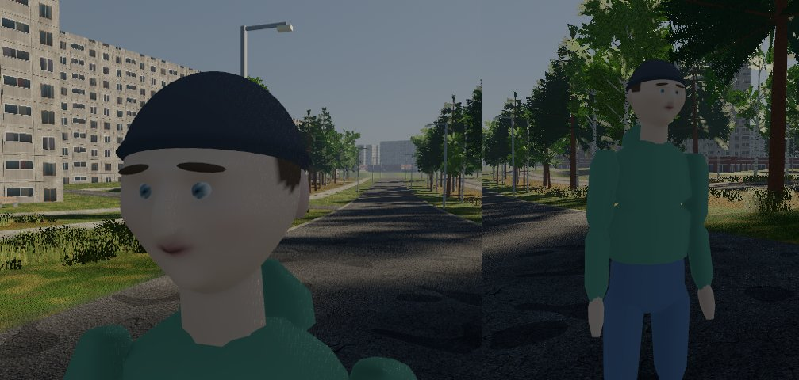
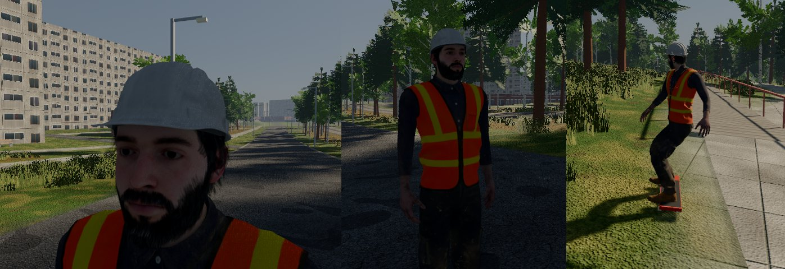

# ЖБИ на Godot 4: прототип

Кусок района 640 × 640 м вокруг лестницы на Высоцкого, собранный из тех же данных карты, что и версия на Unreal: реальный рельеф, 94 дома, дороги, тропинки, лестницы, лавки и деревья. Рендер Forward+: тени от солнца, SSAO, объёмный туман, физическое небо, PBR-текстуры (те же, что в Unreal-версии), объёмные берёзы, липы и сосны, трава вокруг камеры.



| | |
|---|---|
|  |  |
|  |  |
|  |  |

## Как открыть

1. Скачай Godot 4.4 или новее, обычную версию (не .NET): https://godotengine.org/download. Установка не нужна, это один файл.
2. Запусти Godot → **Import** → выбери `godot/project.godot` из репозитория → **Import & Edit**.
3. Первый раз Godot минуту импортирует текстуры. Потом жми **F5** (или ▶ справа сверху).

Если тормозит, нажми **F2**: 3D будет рисоваться в 60% разрешения.

## Управление

| Действие | Клавиатура | Геймпад |
|---|---|---|
| Скейт ↔ пешком / BMX ↔ пешком | F / B | D-pad влево / вправо |
| Пешком: идти | WASD (относительно камеры) | левый стик |
| Толчок / педали | W | левый стик вперёд |
| Тормоз | S | B |
| Поворот, в воздухе вращение | A / D | левый стик |
| Олли / банни-хоп (с рельса тоже), прыжок пешком | Пробел | A |
| Скейт: Kickflip / Heelflip / Shove-it | J / K / L | X / RB / LB |
| BMX: Barspin / Tailwhip / X-Up | J / K / L | X / RB / LB |
| Грэб (скейт) / Superman (BMX), держать | I | Y |
| Респаун / следующий спот | R / T | Back / D-pad вверх |

Грайнд ловится сам, если падаешь сверху на перила, лавку или бордюр (на BMX это пеги). Во время грайнда держи баланс клавишами A/D (полоска снизу). Если приземлиться посреди трюка, боком или врезаться в стену на скорости, будет бэйл и комбо сгорит.

## Персонаж

Райдер собран в коде (`scripts/rider_rig.gd`): скелет из 17 костей и сглаженное тело с одеждой (худи, джинсы, кеды, шапка). Анимации процедурные: шаг и бег от скорости, стойка на доске, толчок ногой, присед в воздухе, грэб, баланс на рельсе, падение. Ноги и руки ставятся через IK: на доске ступни стоят на деке, на BMX ноги крутят педали, а руки держат руль (и крестом при X-Up). BMX (`scripts/bmx_bike.gd`) собран из примитивов: крутятся колёса и шатуны, руль и рама поворачиваются на рулевой колонке для барспина и тейлвипа.

Лицо тоже вылеплено в коде: голова деформируется под скулы, нос, подбородок, надбровья и глазницы, поверх идут глаза с радужкой, веки, брови, уши, губы и волосы из-под шапки. Верхние веки висят на отдельной кости и моргают каждые несколько секунд.



### Готовый персонаж из Mixamo

Если положить модель персонажа с Mixamo (FBX или GLB, в T-позе, скачанную без анимаций) в папку `godot/characters/`, игра наденет её вместо самодельного тела (`scripts/mixamo_body.gd`). Самодельный скелет продолжает считать позы и IK, его суставы подгоняются под пропорции модели, а повороты костей каждый кадр переносятся на скелет Mixamo. Пальцы слегка согнуты, волосам включается прозрачность. Папка в `.gitignore`: модели Mixamo нельзя выкладывать в открытый репозиторий, поэтому каждый кладёт файл себе сам. Сейчас проверено на `Ch17_nonPBR.fbx` (рабочий в каске).



Крупные планы лица без остальной экскурсии: `SHOTS_ONLY=face godot --path . -- --shots=shots`.

## Что внутри

| Путь | Что |
|---|---|
| `scenes/main.tscn` | Уровень: небо, солнце, туман, скейтер, камера, HUD |
| `scripts/world_builder.gd` | Строит мир при запуске из `data/`: рельеф с коллизией, дороги, дома, деревья, лавки, фонари, рельсы для грайнда |
| `scripts/skater.gd` | Игрок: пешком, скейт и BMX. Накат, уклоны, олли, трюки, вращения, грайнд с балансом, бэйлы, очки и комбо |
| `scripts/rider_rig.gd`, `scripts/bmx_bike.gd` | Персонаж со скелетом и анимациями; велосипед |
| `scripts/chase_camera.gd` | Камера за спиной, как в старых THPS |
| `scripts/hud.gd`, `scripts/controls.gd` | Счёт и комбо; раскладка клавиатуры и геймпада |
| `data/` | Готовый кусок карты (высоты, цвета земли, дома и дороги в JSON) |
| `textures/pbr/` | PBR-текстуры домов, дорог и земли (`tools/import_pbr.py`) |
| `textures/foliage/` | Листья, хвоя, кора, трава (`tools/gen_foliage.py`) |
| `shaders/terrain.gdshader` | Земля: трава, лесная подстилка, грунт, плитка и асфальт по маскам |
| `scripts/grass.gd` | Трава кусками вокруг камеры |
| `tools/build_chunk.py` | Вырезает кусок из `MapData/` (можно взять другой центр и размер) |
| `tools/gen_textures.py` | Простые текстуры лестниц, бордюров (и старые ретро-текстуры) |

Всё, кроме картинок и высот, хранится обычным текстом, поэтому сцену и код можно менять прямо в репозитории.

## Другой кусок района

```
pip install numpy pillow shapely mapbox_earcut
python godot/tools/build_chunk.py --center -180 1080 --size 640
```

Центр задаётся в метрах от центра карты (X на восток, Y на север), как в `MapData/geojson`. Вокруг играбельного квадрата рисуется упрощённый район на 2,5 км, чтобы не было края света.

## Скриншоты без редактора

```
godot --path godot -- --shots=/путь/к/папке
```

Игра сама проедет тур (старт, лестница, грайнд, кикфлип, пешком, BMX, тейлвип, двор), сохранит 8 кадров и закроется.

## Чего пока нет

- NPC и заданий.
- Анимаций с захватом движения: даже с моделью Mixamo движения пока процедурные. Следующий шаг: подключить клипы Mixamo (ходьба, бег, толчок) для режима пешком.
- Пальцев и мимики: кисти пока цельные, лицо не меняет выражение.
- Ступенек в физике: рельеф сглажен, поэтому лестница работает как горка, а перила стоят на 0,9 м над ней.
- Лавки у подъездов и фонари вдоль больших дорог расставлены по правилу, в OSM их почти нет.

Данные: © OpenStreetMap contributors (ODbL), Overture Maps Foundation, Microsoft Building Footprints (ODbL), Copernicus WorldDEM-30 © DLR e.V. 2010-2014 and © Airbus Defence and Space GmbH 2014-2018.
